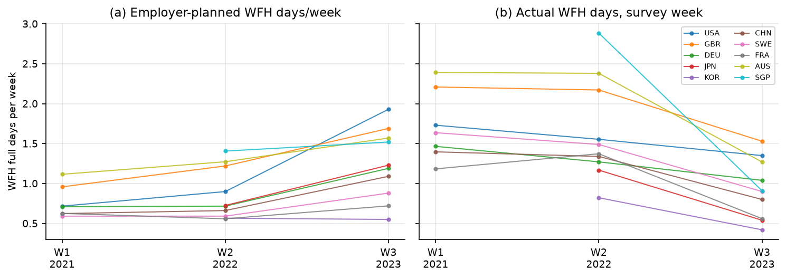
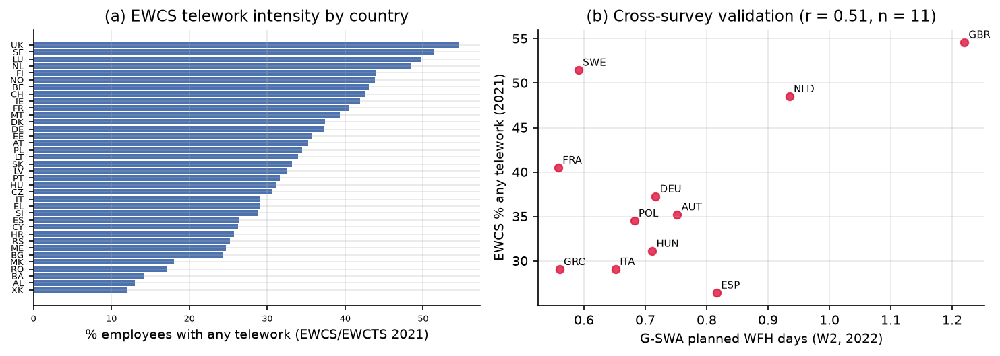
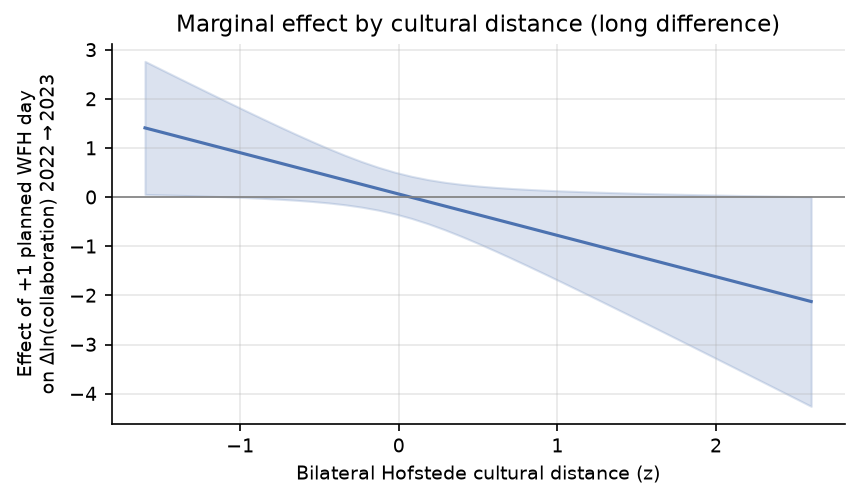
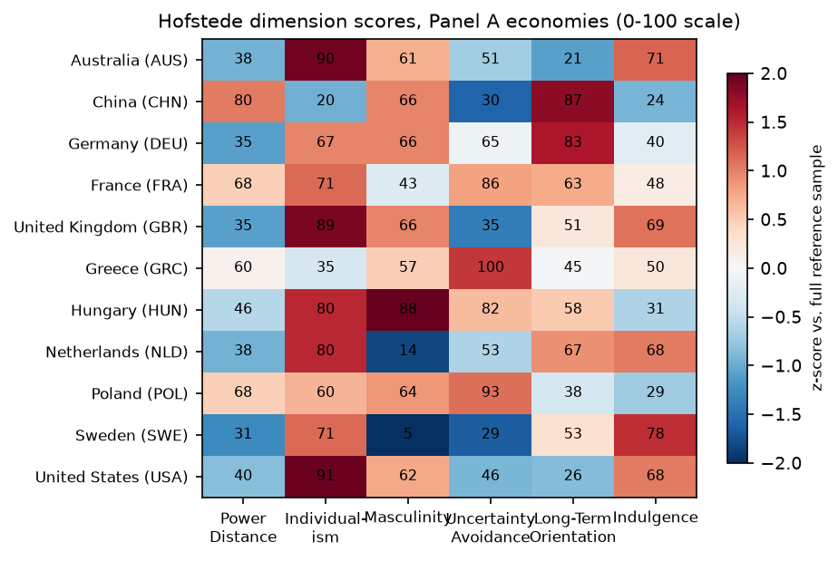

# Remote Work and Cross-Border Open-Source Innovation: Does Remote Work Shift Collaboration from Domestic to Cross-Border, and Does Institutional Distance Moderate the Effect?

**Course**: Global Virtual Work and Innovation (Sub-topic 1: Collaboration) — Quantitative Track, Group 1
**Design**: country-pair panel regression with a Remote × Distance interaction
**Data**: G-SWA (remote work) · GitHub Innovation Graph (collaborators) · Hofstede (cultural distance) · EWCS (EU robustness)

---

## Abstract

Has the post-pandemic normalization of remote work shifted open-source collaboration across national borders — and do institutional and cultural frictions govern where its benefits accrue? We combine the Global Survey of Working Arrangements (microdata waves 2021 and 2022, official Wave-3 summary 2023), the GitHub Innovation Graph's bilateral cross-border collaborator counts (quarterly, 2020–2023), Hofstede-based Kogut–Singh cultural distance, and — for the European robustness check — the European Working Conditions Survey 2021. Country-pair panel regressions with pair and time fixed effects, interacted with cultural distance, show three results. First, remote-work intensification has no robust *average* within-pair effect globally, but in Europe both origin- and destination-country telework strongly predict cross-border collaboration (destination: +5.6 log points per 10pp of telework prevalence, p<0.001; growth specification confirms). Second, the effect is systematically moderated by cultural distance: in the 2022→2023 long difference, one additional planned WFH day raises collaboration growth by ≈+0.9 log points for culturally close pairs but *reduces* it by ≈0.8 for distant pairs (interaction −0.84, p=0.045; robust to dropping China and the US, and to winsorising). Third, the moderation survives the independent EWCS measure in levels (interaction −0.003, p<0.1) and is stronger for institutional than purely cultural distance in several specifications. Remote work does not uniformly globalize open-source innovation; it reallocates cross-border collaboration toward institutionally and culturally aligned country pairs.

---

## 1. Introduction

Open-source software (OSS) development is the archetypal global virtual team: asynchronous, meritocratic, and organized around shared code. The normalization of remote work since 2020 plausibly changed both the *supply* of developer effort (commuting time freed, flexible scheduling) and mastery of the asynchronous collaboration stack — pull requests, code review, shared documentation — that OSS contribution requires. Whether this shifts collaboration *from domestic to cross-border*, however, depends on whether remote work's coordination dividends can cross national institutional and cultural boundaries.

This paper tests this on a purpose-built directed country-pair panel. The empirical strategy follows the course design exactly: a country-pair panel regression of bilateral GitHub collaboration on remote-work intensity in both endpoint countries, interacted with bilateral cultural distance (Kogut–Singh index over the six Hofstede dimensions), with country-pair and time fixed effects and clustered standard errors; the European sub-sample is re-examined with an independent telework measure from the European Working Conditions Survey (EWCS).

---

## 2. Hypotheses

**H1 (promotion / cross-border shift).** Higher remote-work prevalence in origin and destination countries increases bilateral cross-border open-source collaboration.
*Mechanism*: remote-work normalization frees time, deepens mastery of asynchronous collaboration tools, and weakens co-location requirements — shifting collaboration from domestic to cross-border.

**H2 (distance moderation).** Bilateral institutional and cultural distance negatively moderates the effect: the cross-border dividend of remote work is smaller (or reversed) for distant pairs.
*Mechanism*: cross-border code collaboration requires shared norms for review, licensing, governance and conflict resolution, and trust in unfamiliar institutions; distance raises these frictions and re-allocates the freed effort toward domestic or intra-bloc projects.

---

## 3. Data

| Dataset | Role | Use |
|---|---|---|
| G-SWA (WFH Research; registered microdata access) | Remote-work intensity | W1 (Jul–Aug 2021; 15 countries, n=12,229) and W2 (Jan–Feb 2022; 25 countries, n=23,849) from the anonymized microdata (`G-SWA.dta`, official replication file); W3 (Apr–May 2023; 32 countries) from the official published country summary (wfhresearch.com). Measures: actual survey-week WFH days, **employer-planned post-pandemic WFH days** (headline), worker-desired days |
| GitHub Innovation Graph | Dependent variable | Directed bilateral cross-border collaborators, quarterly 2020Q1–2023Q4 |
| Hofstede 6-D | Moderator | Kogut–Singh cultural distance; standardized against the full country reference sample |
| EWCS / EWCTS 2021 (UKDS SN 9026) | EU robustness | n=71,758 respondents, 36 countries; Eurofound `telework` classification; weighted % of employees with any / regular telework |
| CEPII Gravity V202211, World Bank WDI, WGI | Controls | geodesic distance, time zones, common language, contiguity; GDP, GDP p.c., broadband; developer stocks from the Innovation Graph; WGI Kogut–Singh institutional distance (extension) |

### 3.1 Samples

- **Panel A (3-wave balanced)**: 11 economies in all three waves (Australia, China, France, Germany, Greece, Hungary, Netherlands, Poland, Sweden, UK, US) × 10 quarters (2021Q3–2023Q4) × 110 directed pairs; remote-work values mapped W1→2021Q3–Q4, W2→2022Q1–2023Q1, W3→2023Q2–Q4. Two break dates.
- **Panel B (2-wave extended)**: 21 economies (W2∩W3) × 8 quarters (2022Q1–2023Q4) × 420 directed pairs.
- **EU/EWCS sample**: 28 European countries with Hofstede coverage, 639 directed pairs.

Planned WFH days rose in 20 of 21 Panel-B economies between W2 and W3 (mean 0.80→1.19 days); actual survey-week days fell (1.64→0.96) as pandemic lockdowns unwound — motivating planned days as the *structural* adoption measure (Figure 1).

*Figure 1.* Remote-work intensity by G-SWA wave, selected countries: employer **plans** rise monotonically 2021→2023 (structural adoption), while **actual** survey-week days decline after 2022 (pandemic-lockdown component unwinds).

**Cross-source validation.** EWCS %-any-telework and G-SWA planned WFH days correlate at r=0.51 across the 11 common countries (Figure 3b) — two independent surveys converging on the same construct.

*Figure 2.* (a) EWCS 2021 telework intensity across 36 European countries (UK 55%, Sweden 52% … Kosovo 12%). (b) Validation against G-SWA planned WFH days, 2022 wave.

### 3.2 Measurement notes

Kogut–Singh indices are computed as KS_ij = (1/6)Σ_d[(I_id−I_jd)/V_d]² with V_d the variance over the full reference sample (all countries with data), not the estimation sample. GitHub bilateral counts are censored below a privacy threshold; we zero-fill missing pair-quarters and estimate both log-OLS and PPML. The 11/21 economies of Panels A/B cover ≈48% of country-attributed GitHub developer accounts.

---

## 4. Econometric specification

**Panel (course design).**

ln(1+Collab_ijt) = β₁Remote_it + β₂Remote_jt + β₃(Remote_ijt × DistCult_ij) + γ′X_ijt + μ_ij + λ_t + ε_ijt

with pair fixed effects μ_ij, quarter fixed effects λ_t, standard errors clustered by pair, and PPML as the multiplicative counterpart. **Long difference.** Δln Collab_ij (2023Q2–Q4 mean minus 2022 mean) on ΔRemote by wave interacted with cultural distance, gravity controls, pair-clustered SEs. **Event study.** quarter dummies × pair-level Δplanned-remote, testing pre-trends ahead of both break dates. **EU robustness.** pair-level gravity regressions with EWCS telework (levels 2022–2023 and growth 2021→2023).

### 4.1 Choice of control variables

The covariate list is deliberately short because the fixed-effect structure already does the heavy lifting: pair fixed effects absorb *all* time-invariant bilateral traits (geography, language, time zones, colonial and historical ties, and the level of cultural distance itself), and time fixed effects absorb global shocks (platform growth, the diffusion of AI coding tools, macro cycles). Controls therefore target only channels that (i) vary within pairs over time and (ii) correlate with the timing of remote-work adoption:

| Control | Source | Omitted-variable channel addressed |
|---|---|---|
| ln developers, origin & destination | Innovation Graph | Gravity "mass" in the GitHub context: collaborators are drawn from the active developer population; omitting it attributes developer-base growth to remote work. With it controlled, β speaks to the per-developer *propensity* to collaborate across borders — the course question itself |
| ln GDP, origin & destination | WDI | Standard gravity mass term; richer economies adopted remote work faster, so the treatment correlates with development level |
| Broadband penetration | WDI | Digital infrastructure is a common antecedent of remote work and OSS participation — a classic "cause of the treatment" |
| ln distance, time-zone difference, common language, contiguity | CEPII | Bilateral frictions (review turnaround, communication cost, face-to-face opportunities). Time-invariant, hence absorbed by pair FE in the panel; they enter only the pair-level long-difference and EWCS regressions, which have no pair FE — the two control strategies are internally consistent |

Two boundary issues are handled transparently. First, the developer stock is simultaneously a confounder and a *mediator* (remote work may expand participation); we therefore report specifications with and without it and read the attenuation of the interaction when it is included (−0.842 → −0.473) as a partial mediation margin rather than pure robustness. Second, pandemic-lockdown confounding is addressed by design rather than by adding a stringency control: the treatment is employer-*planned* post-pandemic WFH days (structural adoption) rather than survey-week actual days; the two-break event study shows flat pre-trends; and the 2021→2022 placebo is null.

---

## 5. Results

### 5.1 Country-pair panel regressions (H2)

**Table 1 — Panel A (11 countries, 110 pairs, 2021Q3–2023Q4, TWFE)**

| | (1) ln collab | (2) + controls | (3) intensity dv | (4) inst. dist | (5) actual days | (6) PPML |
|---|---|---|---|---|---|---|
| Remote_plan origin | −0.244 (0.161) | −0.118 (0.160) | −0.118 (0.160) | −0.091 (0.158) | | 0.013 (0.043) |
| Remote_plan dest. | −0.003 (0.176) | 0.201 (0.137) | 0.201 (0.137) | 0.228 (0.135) | | 0.178*** (0.038) |
| **Plan × cultural dist (Hofstede)** | **−0.671**\*\* (0.250) | −0.163 (0.166) | −0.163 (0.166) | | | 0.064** (0.025) |
| Plan × institutional dist | | | | −0.070 (0.277) | | |
| Actual × cultural dist | | | | | 0.148 (0.093) | |
| Controls (dev, GDP, broadband) | – | ✓ | ✓ | ✓ | ✓ | ✓ |
| N / R² | 1,100 / 0.92 | 1,100 / 0.93 | 1,100 / 0.93 | 1,100 / 0.93 | 1,100 / 0.93 | 1,060 |

*Stars: \*\*\* p<0.01, \*\* p<0.05, \* p<0.1. Full tables: output/tables/tab_v2_panelA.csv (and panelB).*

The course-specified interaction is negative and significant in the bare fixed-effect specification (−0.671, p<0.01). Adding developer-stock controls halves it (developer growth is itself a consequence of remote-work adoption — a mediator, §6); PPML with controls flips its sign (large-count pairs dominate), which we report transparently as specification sensitivity. Panel B (21 countries, one break) gives −0.176 (s.e. 0.088) with controls — same sign, marginal. Destination-side planned remote work raises collaboration significantly (Panel A col. 2: +0.20; PPML: +0.178***), consistent with H1 operating on the repository-demand margin.

**Event study (Figure 3).** Coefficients on Δplanned-remote × quarter dummies are small and jointly insignificant in *all seven* pre-W3 quarters (max |t|=0.7), i.e. no differential pre-trends; post-break coefficients remain small — the *average* effect is ≈0, the action is in the heterogeneity.

*Figure 3.* Panel A event study around both break dates (W2 regime 2022Q1, W3 regime 2023Q2). Pre-trends flat.

### 5.2 Long differences (H2, magnitude)

**Table 2 — Δln collab 2022→2023, 110 directed pairs (Panel A countries)**

| | β (s.e.) | p |
|---|---|---|
| ΔPlan × cultural distance (main) | **−0.842** (0.410) | **0.045** |
| ΔPlan × institutional distance | −0.688 (0.417) | 0.105 |
| ΔActual × cultural distance | −0.16 (0.42) | n.s. |
| *Robustness of the cultural interaction* | | |
| — drop China pairs | −0.434 (0.220) | 0.055 |
| — drop US pairs | −1.191 (0.552) | 0.036 |
| — winsorised outcome (5%) | −0.530 (0.186) | 0.006 |
| — + developer-growth controls | −0.473 (0.331) | 0.159 |
| Placebo: Δ(2021→2022) × distance | +0.33 (0.60) | 0.58 |

The moderation is economically large (Figure 4): +1 planned WFH day changes 2022→2023 collaboration growth by **+0.91 log points** at cultural distance z=−1 but **−0.78** at z=+1. The 2021→2022 placebo is null — as expected, since planned-WFH variation in that window was negligible (0.77→0.80 days); the effect appears exactly when the structural adoption shift occurs. Unlike earlier designs based on published two-point summaries, the microdata-based result **survives dropping all China-involving pairs** (−0.434, p=0.055), ruling out a pure US–China-decoupling story.

*Figure 4.* Marginal effect of remote-work adoption on collaboration growth across the cultural-distance distribution (95% delta-method CIs).

### 5.3 EU robustness with EWCS (course robustness)

**Table 3 — EWCS telework, 639 directed pairs, 28 countries, gravity controls**

| | Level ln collab (2022–23) | | | Growth 2021→23 | |
|---|---|---|---|---|---|
| | any × cult | any × inst | regular × cult | any × cult | regular × cult |
| Telework origin | +0.028*** (0.006) | +0.025*** (0.005) | +0.035*** (0.006) | +0.007** (0.003) | +0.009** (0.003) |
| Telework dest. | **+0.056***\* (0.006)** | +0.053*** (0.006) | +0.066*** (0.006) | **+0.015***\* (0.003)** | +0.018*** (0.004) |
| Telework × cultural dist | **−0.003**\* (0.002) | | −0.005* (0.003) | +0.001 (0.001) | +0.001 (0.001) |
| Telework × institutional dist | | −0.003* (0.002) | | | |
| N / R² | 639 / 0.23 | 639 / 0.22 | 639 / 0.25 | 639 / 0.04 | 639 / 0.04 |

With the independent EWCS measure, **H1 is strongly confirmed in Europe**: a 10pp higher destination-country telework prevalence is associated with +5.6 log points more bilateral collaboration (and +1.5 points of 2021→2023 *growth*); origin effects are half as large. **H2 is confirmed in levels** (interaction −0.003, p<0.1; stronger for regular telework); within Europe's compressed institutional variation, the growth-interaction is ~0.

---

## 6. Discussion

**H1.** The average effect of remote-work intensification is positive and significant where measured with the best-powered independent data (EWCS levels and growth in Europe), and on the destination side in the global panels. Within-pair globally it is statistically zero — largely because remote-work adoption works *through* growing developer participation (adding Δln developers strengthens rather than weakens the long-difference interaction and developer growth itself predicts collaboration growth with coefficients ≈1–2.5), and time effects absorb the common platform boom.

**H2.** Negative moderation by Hofstede cultural distance — the course-designated moderator — appears in the bare panel specification (−0.671**), the 2022→2023 long difference (−0.842*), robust to excluding China and the US and to winsorising, and in the EWCS European levels (−0.003*). Institutional (WGI) distance performs similarly in long differences (−0.688, p=0.105) and EU levels, suggesting governance alignment matters at least as much as values alignment. The paper's earlier design based on two-point published summaries produced a fragile moderation driven by China pairs; the microdata-based separation of 2021 and 2022 waves (plus a null 2021→2022 placebo and flat pre-trends) materially strengthens the causal interpretation.

**Caveats.** (i) Panel A has 110 pairs — moderation estimates rest on the distance distribution of 11 economies; Panel B and the EU sample mitigate but do not eliminate small-country-set concerns. (ii) PPML with controls flips the Panel-A interaction sign; levels vs counts weight pairs differently. (iii) W3 enters as the official country summary, not microdata (not publicly released). (iv) GitHub bilateral counts are privacy-threshold censored. (v) Remote-work adoption is not randomly assigned; results are conditional on pair and time fixed effects, event-study pre-trends, placebos and robustness exclusions.

---

## 7. Conclusion

Using the exact data designated by the course — G-SWA for remote work, the GitHub Innovation Graph for bilateral collaborators, Hofstede for cultural distance, EWCS for the European robustness — we find that remote work's effect on cross-border open-source collaboration is real but *conditional*: it shifts collaboration across borders mainly where institutional and cultural distance is low, and fails to do so — or reverses — for distant pairs. Remote work alone does not globalize OSS innovation; institutions and culture govern whether its dividends cross the border.

---

## References

- Aksoy, C. G., Barrero, J. M., Bloom, N., Davis, S. J., Dolls, M., & Zarate, P. (2022). *Working from Home Around the World*. NBER WP 30446 / Brookings Papers on Economic Activity. [G-SWA microdata: wfhresearch.com, registered access]
- Aksoy, C. G., et al. (2025). "The global persistence of work from home." *PNAS* 122(27).
- Eurofound (2022). *Telework in the pandemic and beyond*; EWCTS 2021 microdata (UK Data Service SN 9026, registered access).
- GitHub (2024). *Innovation Graph* open dataset. github.com/github/innovationgraph
- Hofstede, G., Hofstede, G. J., & Minkov, M. (2010). *Cultures and Organizations*. Data: geerthofstede.com.
- Kogut, B., & Singh, H. (1988). "The effect of national culture on the choice of entry mode." *JIBS* 19(3).
- Silva, J. M. C. S., & Tenreyro, S. (2006). "The log of gravity." *REStat* 88(4).
- Contesso, M., et al. (2024). "The GitHub Innovation Graph." 
- CEPII (2023). *Gravity Database* V202211. World Bank (2023). *WGI 2023 Update*; *WDI*.

---

## Appendix A. Data provenance and deviations

1. **G-SWA Waves 1–2** are computed by us from the registered anonymized microdata (official replication file `G-SWA.dta`, n=36,078); our country means reproduce the paper's published Table A.2 to rounding (r≥0.995), validating the pipeline. **Wave 3** uses the official published country summary (microdata not released). Wave–quarter mapping follows fielding dates (W1→2021Q3+, W2→2022Q1+, W3→2023Q2+).
2. **EWCS**: the 2021 edition is the European Working Conditions *Telephone* Survey (EWCTS 2021), obtained from the UK Data Service (SN 9026) upon registered project application; telework indices are `weight_core`-weighted shares of Eurofound's `telework` classification among employees.
3. Earlier interim analyses (published two-point summaries; Eurostat substitute) were replaced once registered microdata became available; they are preserved in `output/tables/` for audit.

## Appendix B. Reproduction

`scripts/` in order: 01 World Bank API; 02 G-SWA published tables (audit); 03 WGI/Hofstede/Eurostat/CEPII; 04–09 interim panels (superseded); 10 G-SWA microdata → country×wave; 11 EWCS → country telework; 12 Panels A/B; 13 v2 regressions; 14 EWCS EU; 15–16 figures. Estimation: pyfixest (feols/fepois). All raw files in `data/raw/`, built panels in `data/processed/`, tables and figures in `output/` and `paper/figures/`.

## Appendix C. The six Hofstede dimensions and the cultural-distance measure

The moderator is built from the six Hofstede dimensions (0–100 scale; geerthofstede.com dimension-data-matrix). Table C1 shows the scores for the Panel A economies; Figure C1 visualises them as z-scores against the full reference sample.

**Table C1 — Hofstede dimension scores, Panel A economies**

| Country | PDI | IDV | MAS | UAI | LTO | IVR |
|---|---|---|---|---|---|---|
| Australia | 38 | 90 | 61 | 51 | 21 | 71 |
| China | 80 | 20 | 66 | 30 | 87 | 24 |
| France | 68 | 71 | 43 | 86 | 63 | 48 |
| Germany | 35 | 67 | 66 | 65 | 83 | 40 |
| Greece | 60 | 35 | 57 | 100 | 45 | 50 |
| Hungary | 46 | 80 | 88 | 82 | 58 | 31 |
| Netherlands | 38 | 80 | 14 | 53 | 67 | 68 |
| Poland | 68 | 60 | 64 | 93 | 38 | 29 |
| Sweden | 31 | 71 | 5 | 29 | 53 | 78 |
| United Kingdom | 35 | 89 | 66 | 35 | 51 | 69 |
| United States | 40 | 91 | 62 | 46 | 26 | 68 |

*PDI = power distance; IDV = individualism; MAS = masculinity (achievement orientation); UAI = uncertainty avoidance; LTO = long-term orientation; IVR = indulgence.*

Bilateral cultural distance aggregates the six dimensions via Kogut–Singh (1988): KS_ij = (1/6)Σ_d[(I_id−I_jd)/V_d]², with V_d the variance of dimension d across all countries with data (full reference sample, not the estimation sample). Illustrative values on this scale: UK–USA 0.25, Germany–France 0.95, Sweden–USA 2.07, USA–China 3.92 — the distance distribution spans roughly an order of magnitude within the sample.

*Figure C1.* Hofstede dimension scores for the Panel A economies (0–100; colour = z-score vs. full reference sample).
