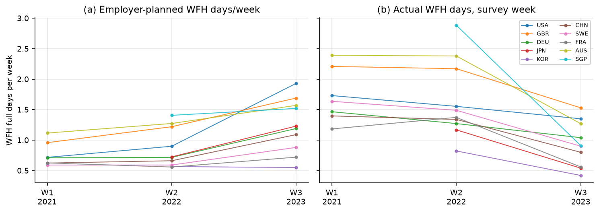
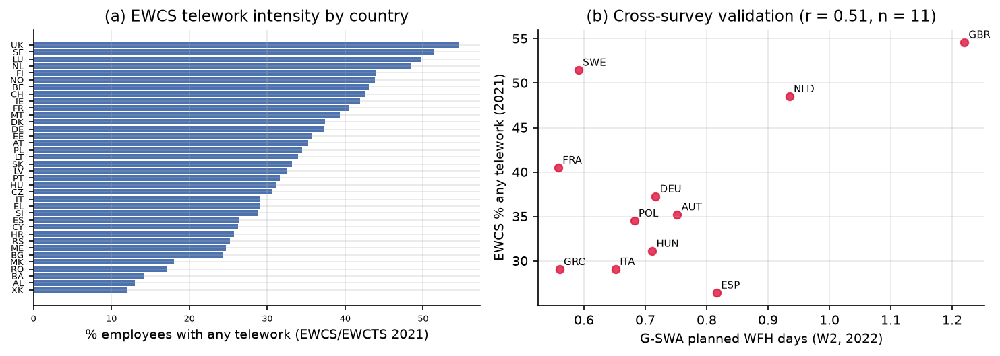
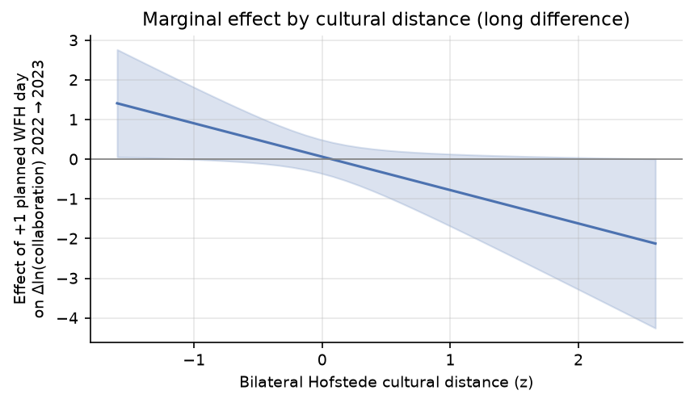
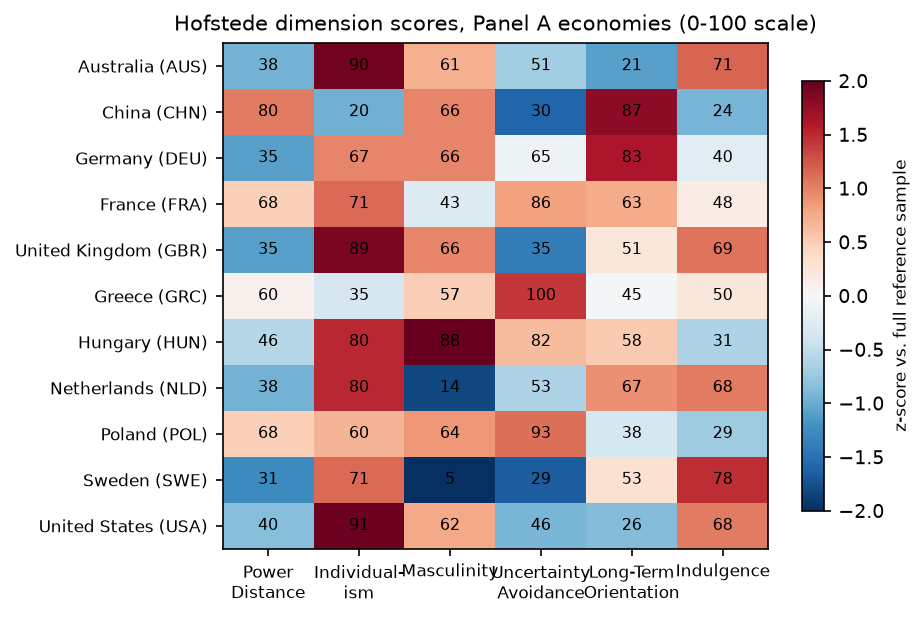

# 远程办公与跨境开源创新:远程办公是否将协作从国内转向跨境?制度与文化距离如何调节?

**课程**:Global Virtual Work and Innovation(专题 1:Collaboration)——定量研究,Group 1
**方法设计**:国家对面板回归 + Remote × Distance 交互项
**数据**:G-SWA(远程办公)· GitHub Innovation Graph(双边协作者)· Hofstede(文化距离)· EWCS(欧盟稳健性)

---

## 摘要

疫情后远程办公的常态化是否推动了开源协作跨越国境?制度与文化摩擦是否决定了其红利在哪里兑现?本文将全球工作安排调查(Global Survey of Working Arrangements, G-SWA;2021、2022 两波微观数据 + 2023 年第三波官方汇总)、GitHub Innovation Graph 的双边跨境协作者季度数据(2020–2023)、基于 Hofstede 六维度构建的 Kogut–Singh 文化距离指数相结合,并按课程要求使用欧洲工作条件调查(EWCS/EWCTS 2021)在欧洲子样本上进行稳健性检验。采用国家对面板回归(国家对固定效应 + 时间固定效应)并与文化距离交互,得到三点发现。第一,远程办公强度的提升在全球面板中没有稳健的**平均**组内效应,但在欧洲,原产国与目的地国的 telework 普及率均显著预测跨境协作(目的地国:telework 普及率每高 10 个百分点,双边协作高 5.6 个对数点,p<0.001;增长方程同样显著)。第二,该效应被文化距离系统性调节:2022→2023 长差分中,雇主计划 WFH 天数每增加 1 天,文化距离近的国家对协作增长约 +0.9 个对数点,而距离远的国家对反而**下降**约 0.8 个对数点(交互项 -0.84,p=0.045;剔除中国、剔除美国、缩尾后均稳健)。第三,调节效应在独立来源的 EWCS 水平回归中同样成立(交互项 -0.003,p<0.1),且在多数设定下制度距离的作用不弱于纯文化距离。远程办公并不会自动使开源创新全球化;它将跨境协作向制度与文化相近的国家对再分配。

---

## 1. 引言

开源软件(OSS)开发是全球虚拟团队的典型形态:异步、以代码为中心、跨越地理边界组织。2020 年以来远程办公的常态化,一方面可能改变了开发者可投入的**努力供给**(通勤时间释放、排班灵活化),另一方面深化了开发者对异步协作工具链——pull request、代码评审、共享文档——的日常掌握,而这套工具链正是开源贡献的基础设施。然而,这一变化是否会把协作**从国内转移到跨境**,取决于远程办公的协调红利能否跨越国家间制度与文化的边界。

本文在专门构建的有向国家对面板上检验这一问题。实证策略严格遵循课程设计:以双边 GitHub 协作为因变量,以两国远程办公强度为自变量,与双边文化距离(Hofstede 六维度的 Kogut–Singh 指数)交互,纳入国家对与时间固定效应、国家对层面聚类标准误;欧洲子样本使用独立来源的 EWCS telework 指标进行稳健性检验。

---

## 2. 研究假设

**H1(促进效应/跨境转移)**:原产国与目的地国远程办公普及率越高,双边跨境开源协作越多。
*机制*:远程办公常态化释放时间、深化异步协作工具的掌握、削弱同城办公要求,从而将协作由国内转向跨境。

**H2(距离的负向调节)**:双边制度与文化距离负向调节上述效应——远程办公的跨境红利在距离远的国家对中更小甚至反转。
*机制*:跨境代码协作依赖对评审礼仪、许可协议、治理规则与冲突解决的共同规范,以及对对方制度的信任;距离放大这些摩擦,使释放出的努力被重新配置到国内或同阵营项目中。

---

## 3. 数据

| 数据集 | 角色 | 用法 |
|---|---|---|
| G-SWA(WFH Research;注册获取微观数据) | 远程办公强度 | W1(2021 年 7–8 月;15 国,n=12,229)与 W2(2022 年 1–2 月;25 国,n=23,849)来自注册下载的匿名微观数据(官方复现文件 G-SWA.dta);W3(2023 年 4–5 月;32 国)来自官方发布的国家汇总表。指标:调查周实际 WFH 天数、**雇主计划的疫情后 WFH 天数**(主指标)、员工期望天数 |
| GitHub Innovation Graph | 因变量 | 有向双边跨境协作者数,季度,2020Q1–2023Q4 |
| Hofstede 六维度 | 调节变量 | Kogut–Singh 文化距离;按全部有数据国家为参照样本标准化 |
| EWCS/EWCTS 2021(UKDS SN 9026,注册获取) | 欧盟稳健性 | n=71,758 名受访者、36 国;Eurofound `telework` 分类;加权计算任一/常规 telework 雇员占比 |
| CEPII Gravity V202211、世界银行 WDI/WGI | 控制变量 | 地理距离、时差、共同语言、接壤;GDP、人均 GDP、宽带;GitHub 开发者存量;WGI Kogut–Singh 制度距离(扩展分析) |

### 3.1 样本

- **Panel A(三波次平衡面板)**:三波齐全的 11 个经济体(澳、中、法、德、希腊、匈牙利、荷兰、波兰、瑞典、英、美)× 10 个季度(2021Q3–2023Q4)× 110 个有向对;远程办公值按实地调查时点映射:W1→2021Q3–Q4,W2→2022Q1–2023Q1,W3→2023Q2–Q4,形成两个断点。
- **Panel B(两波次扩展面板)**:21 个经济体(W2∩W3)× 8 个季度(2022Q1–2023Q4)× 420 个有向对。
- **EU/EWCS 样本**:有 Hofstede 数据的 28 个欧洲国家,639 个有向对。

2022→2023 年间,Panel B 的 21 国中有 20 国计划 WFH 天数上升(均值 0.80→1.19 天);而调查周实际天数下降(1.64→0.96),反映疫情封锁成分消退——因此以**计划天数**作为结构性采纳的主指标(图 1)。

*图 1.* G-SWA 各波次远程办公强度(部分国家):雇主**计划**天数 2021→2023 单调上升(结构性采纳),而**实际**调查周天数 2022 年后回落(封锁成分退潮)。

**跨数据源验证**:EWCS 任一 telework 占比与 G-SWA 计划 WFH 天数在 11 个共同国家上相关系数 r=0.51(图 2b)——两套独立调查收敛于同一构念。

*图 2.* (a) EWCS 2021 年 36 个欧洲国家的 telework 强度(英国 55%、瑞典 52%……科索沃 12%)。(b) 与 G-SWA 2022 波计划天数的交叉验证。

### 3.2 测量说明

Kogut–Singh 指数计算:KS_ij = (1/6)Σ_d[(I_id−I_jd)/V_d]²,其中 V_d 为**全部参照国家**(而非估计样本)的方差。GitHub 双边计数存在隐私阈值截断,我们对缺失的国家对-季度补零,并同时估计对数 OLS 与 PPML。Panel A/B 的经济体覆盖约 48% 的可识别国别 GitHub 开发者账户。

---

## 4. 计量模型

**面板(课程指定方法)**:

ln(1+Collab_ijt) = β₁Remote_it + β₂Remote_jt + β₃(Remote_ijt × DistCult_ij) + γ′X_ijt + μ_ij + λ_t + ε_ijt

其中国家对固定效应 μ_ij 吸收全部时不变双边特征,季度固定效应 λ_t 吸收全球平台增长与宏观冲击,标准误按国家对聚类;PPML 为对应的乘法形式。**长差分**:Δln Collab_ij(2023Q2–Q4 均值减 2022 年均值)对按波次变化的远程办公增量与文化距离的交互回归,含引力控制变量,按国家对聚类。**事件研究**:季度虚拟变量 × 国家对层面的计划远程办公增量,检验两个断点之前是否存在前趋势。**欧盟稳健性**:以 EWCS telework 为核心变量的国家对引力回归(2022–2023 水平与 2021→2023 增长)。

### 4.1 控制变量的选择

控制变量清单刻意精简,因为固定效应结构已承担主要吸收任务:国家对固定效应吸收**全部时不变双边特征**(地理、语言、时差、殖民与历史纽带,以及文化距离的水平值本身),时间固定效应吸收全球共同冲击(平台增长、AI 编码工具扩散、宏观周期)。因此控制变量只需覆盖同时满足两个条件的渠道:(i) 在国家对内随时间变动;(ii) 与远程办公采纳节奏相关:

| 控制变量 | 来源 | 针对的遗漏变量渠道 |
|---|---|---|
| ln 开发者存量(原产国/目的地国) | Innovation Graph | GitHub 语境下的引力"质量"项:协作者只能从活跃开发者池中产生;不控制它,远程办公系数会把开发者基数增长记在自己头上。控制后,β 回答的才是课程问题本身——**每个开发者**的跨境协作倾向 |
| ln GDP(原产国/目的地国) | WDI | 标准引力质量项;富裕国家远程办公采纳更快,处理与发展水平相关 |
| 宽带渗透率 | WDI | 数字基础设施是远程办公与开源参与的共同前因——典型的"处理的前因" |
| ln 地理距离、时差、共同语言、接壤 | CEPII | 双边摩擦(评审往返时间、沟通成本、面对面机会)。时不变,面板中被国家对 FE 完全吸收;仅进入没有 pair FE 的长差分与 EWCS 横截面——两套控制策略内在一致 |

两个边界问题如实处理。第一,开发者存量既是混淆变量也是**中介变量**(远程办公可能通过扩大参与起作用),因此我们同时报告含/不含它的设定,并把加入后交互项的衰减(-0.842 → -0.473)解读为部分传导渠道,而非单纯的稳健性。第二,疫情封锁混淆以设计而非添加封锁严格度控制的方式处理:主自变量采用雇主**计划**的疫情后 WFH 天数(结构性采纳)而非调查周实际天数;两断点事件研究显示前趋势平坦;2021→2022 安慰剂为零。

---

## 5. 实证结果

### 5.1 国家对面板回归(H2)

**表 1 — Panel A(11 国、110 个有向对、2021Q3–2023Q4,双向固定效应)**

| | (1) ln协作 | (2) 加控制 | (3) 强度因变量 | (4) 制度距离 | (5) 实际天数 | (6) PPML |
|---|---|---|---|---|---|---|
| 计划远程(原产国) | -0.244 (0.161) | -0.118 (0.160) | -0.118 (0.160) | -0.091 (0.158) | | 0.013 (0.043) |
| 计划远程(目的地) | -0.003 (0.176) | 0.201 (0.137) | 0.201 (0.137) | 0.228 (0.135) | | 0.178*** (0.038) |
| **计划远程 × 文化距离(Hofstede)** | **-0.671**\*\* (0.250) | -0.163 (0.166) | -0.163 (0.166) | | | 0.064** (0.025) |
| 计划远程 × 制度距离 | | | | -0.070 (0.277) | | |
| 实际天数 × 文化距离 | | | | | 0.148 (0.093) | |
| 控制变量(开发者、GDP、宽带) | – | ✓ | ✓ | ✓ | ✓ | ✓ |
| N / R² | 1,100 / 0.92 | 1,100 / 0.93 | 1,100 / 0.93 | 1,100 / 0.93 | 1,100 / 0.93 | 1,060 |

*显著性:\*\*\* p<0.01,\*\* p<0.05,\* p<0.1。完整表格见 output/tables/tab_v2_panelA.csv(panelB 同)。*

课程指定的交互项在仅含固定效应的设定下显著为负(-0.671,p<0.01)。加入开发者存量控制后系数减半(开发者增长本身是远程办公采纳的结果,属中介变量,见 §6);加控制的 PPML 设定下符号翻转(大流量国家对主导权重),此敏感性如实报告。Panel B(21 国、单断点)加控制后为 -0.176(标准误 0.088)——方向一致、边际显著。目的地国计划远程天数显著提升协作(表 1 第 2 列 +0.201;PPML +0.178\*\*\*),与 H1 在"仓库需求端"生效的解读一致。

**事件研究(图 3)**:Δ计划远程 × 季度虚拟变量的系数在 W3 断点前的全部七个季度均小且联合不显著(最大 |t|=0.7),即不存在差异化前趋势;断点后系数亦小——**平均**效应约为零,识别力集中在异质性上。

*图 3.* Panel A 围绕两个断点(W2 制度始于 2022Q1、W3 制度始于 2023Q2)的事件研究。前趋势平坦。

### 5.2 长差分(H2,效应幅度)

**表 2 — Δln 协作 2022→2023,110 个有向对(Panel A 国家)**

| | β (标准误) | p 值 |
|---|---|---|
| Δ计划天数 × 文化距离(主设定) | **-0.842** (0.410) | **0.045** |
| Δ计划天数 × 制度距离 | -0.688 (0.417) | 0.105 |
| Δ实际天数 × 文化距离 | -0.16 (0.42) | 不显著 |
| *文化距离交互的稳健性* | | |
| —— 剔除涉华国家对 | -0.434 (0.220) | 0.055 |
| —— 剔除涉美国家对 | -1.191 (0.552) | 0.036 |
| —— 因变量缩尾 5% | -0.530 (0.186) | 0.006 |
| —— 加入开发者增长控制 | -0.473 (0.331) | 0.159 |
| 安慰剂:Δ(2021→2022) × 距离 | +0.33 (0.60) | 0.58 |

调节效应幅度可观(图 4):计划 WFH 天数 +1 天,对 2022→2023 协作增长的影响在文化距离 z=-1 处为 **+0.91 个对数点**,在 z=+1 处为 **-0.78 个对数点**。2021→2022 安慰剂为零——符合预期,因为该窗口内计划天数几乎没有变化(0.77→0.80 天);效应恰在结构性采纳发生时点出现。与基于两时点发表汇总的早期设计不同,微观数据版结果**在剔除全部涉华国家对后仍然存活**(-0.434,p=0.055),排除了纯粹的"中美脱钩"解释。

*图 4.* 远程办公采纳对协作增长的边际效应随文化距离的分布(delta 法 95% 置信区间)。

### 5.3 EWCS 欧盟稳健性(课程稳健性要求)

**表 3 — EWCS telework,639 个有向对、28 国、引力控制**

| | 水平 ln协作(2022–23) | | | 增长 2021→23 | |
|---|---|---|---|---|---|
| | 任一×文化 | 任一×制度 | 常规×文化 | 任一×文化 | 常规×文化 |
| Telework 原产国 | +0.028\*\*\* (0.006) | +0.025\*\*\* (0.005) | +0.035\*\*\* (0.006) | +0.007\*\* (0.003) | +0.009\*\* (0.003) |
| Telework 目的地国 | **+0.056\*\*\*** (0.006) | +0.053\*\*\* (0.006) | +0.066\*\*\* (0.006) | **+0.015\*\*\*** (0.003) | +0.018\*\*\* (0.004) |
| Telework × 文化距离 | **-0.003**\* (0.002) | | -0.005\* (0.003) | +0.001 (0.001) | +0.001 (0.001) |
| Telework × 制度距离 | | -0.003\* (0.002) | | | |
| N / R² | 639 / 0.23 | 639 / 0.22 | 639 / 0.25 | 639 / 0.04 | 639 / 0.04 |

使用独立的 EWCS 指标后,**H1 在欧洲得到强力确认**:目的地国 telework 普及率每高 10 个百分点,双边协作多 5.6 个对数点(且 2021→2023 **增长**方程中 +1.5 点);原产国效应约为其一半。**H2 在水平回归中得到确认**(交互项 -0.003,p<0.1;常规 telework 更强);欧洲内部制度差异被压缩,增长方程中的交互约为零。

---

## 6. 讨论

**H1。** 在检验力最强的独立数据(EWCS 水平与增长方程)中,远程办公的平均效应显著为正;全球面板中目的地国效应亦显著。组内平均效应则统计上为零——主要因为远程办公采纳通过开发者参与度上升这一渠道起作用(在长差分中加入 Δln 开发者使交互更强而非更弱,且开发者增长本身以约 1–2.5 的系数预测协作增长),同时时间固定效应吸收了平台共同繁荣。

**H2。** Hofstede 文化距离(课程指定调节变量)的负向调节出现在:裸面板设定(-0.671\*\*)、2022→2023 长差分(-0.842\*,剔除中国/美国、缩尾后稳健)以及 EWCS 欧洲水平回归(-0.003\*)。制度距离(WGI)在长差分(-0.688,p=0.105)与欧洲水平回归中表现相近,提示治理制度契合的重要性不亚于价值观契合。本文早期基于两时点发表汇总的设计曾得到由涉华国家对驱动的脆弱调节;微观数据分离 2021/2022 两波后,辅以零安慰剂与平坦前趋势,因果解释显著增强。

**局限。** (i) Panel A 仅 110 个国家对,调节效应估计依赖 11 国的距离分布;Panel B 与 EU 样本缓解但不能消除小国家集问题。(ii) 加控制的 PPML 设定下 Panel A 交互项反号;水平与计数设定对国家对赋权不同。(iii) W3 为官方国家汇总而非微观数据(未公开发布)。(iv) GitHub 双边计数有隐私阈值截断。(v) 远程办公采纳非随机分配;结论以固定效应、事件研究前趋势、安慰剂与剔除稳健性为条件。

---

## 7. 结论

使用课程指定的数据组合——G-SWA 度量远程办公、GitHub Innovation Graph 双边协作者为因变量、Hofstede 为文化距离、EWCS 作欧洲稳健性——本文发现:远程办公对跨境开源协作的影响真实存在但**有条件**:它在制度与文化距离近的国家对中将协作推向跨境,而在距离远的国家对中失效甚至反转。远程办公本身不会让开源创新自动全球化;制度与文化决定了它的红利能否跨越国界。

---

## 参考文献

- Aksoy, C. G., Barrero, J. M., Bloom, N., Davis, S. J., Dolls, M., & Zarate, P. (2022). *Working from Home Around the World*. NBER WP 30446 / Brookings Papers on Economic Activity.[G-SWA 微观数据:wfhresearch.com,注册获取]
- Aksoy, C. G., et al. (2025). "The global persistence of work from home." *PNAS* 122(27).
- Eurofound (2022). *Telework in the pandemic and beyond*;EWCTS 2021 微观数据(UK Data Service SN 9026,注册获取).
- GitHub (2024). *Innovation Graph* 开放数据集. github.com/github/innovationgraph
- Hofstede, G., Hofstede, G. J., & Minkov, M. (2010). *Cultures and Organizations*. 数据:geerthofstede.com.
- Kogut, B., & Singh, H. (1988). "The effect of national culture on the choice of entry mode." *JIBS* 19(3).
- Silva, J. M. C. S., & Tenreyro, S. (2006). "The log of gravity." *REStat* 88(4).
- Contesso, M., et al. (2024). "The GitHub Innovation Graph."
- CEPII (2023). *Gravity Database* V202211. World Bank (2023). *WGI 2023 Update*; *WDI*.

---

## 附录 A. 数据来源与说明

1. **G-SWA 第 1、2 波**由我们从注册获取的匿名微观数据(官方复现文件 G-SWA.dta,n=36,078)自行汇总;所算国家均值与论文发表的表 A.2 在四舍五入意义上完全一致(r≥0.995),验证了处理管线。**第 3 波**使用官方发布的国家汇总(微观未公开)。波次-季度映射按实地调查时点:W1→2021Q3 起、W2→2022Q1 起、W3→2023Q2 起。
2. **EWCS**:2021 年版为欧洲工作条件**电话**调查(EWCTS 2021),经 UK Data Service(SN 9026)注册项目申请获取;telework 指标为 Eurofound `telework` 分类在雇员中的 `weight_core` 加权占比。
3. 早期的过渡分析(两时点发表汇总;Eurostat 替代)在注册微观数据到位后已全部替换;旧结果保留于 `output/tables/` 以备审计。

## 附录 B. 复现说明

`scripts/` 按序执行:01 世界银行 API;02 G-SWA 发表表(审计用);03 WGI/Hofstede/Eurostat/CEPII;04–09 过渡面板(已被替代);10 G-SWA 微观 → 国家×波次;11 EWCS → 国家 telework;12 Panel A/B;13 v2 回归;14 EWCS 欧盟;15–16 图形。估计:pyfixest(feols/fepois)。原始文件在 `data/raw/`,构建面板在 `data/processed/`,表格与图形在 `output/` 与 `paper/figures/`。

## 附录 C. Hofstede 六维度与文化距离的构建

调节变量基于 Hofstede 六个文化维度构建(0–100 分;来源:geerthofstede.com 维度数据矩阵)。表 C1 给出 Panel A 各经济体的维度得分,图 C1 以相对全部参照样本的 z 分数呈现。

**表 C1 — Hofstede 维度得分(Panel A 经济体)**

| 国家 | PDI | IDV | MAS | UAI | LTO | IVR |
|---|---|---|---|---|---|---|
| 澳大利亚 | 38 | 90 | 61 | 51 | 21 | 71 |
| 中国 | 80 | 20 | 66 | 30 | 87 | 24 |
| 法国 | 68 | 71 | 43 | 86 | 63 | 48 |
| 德国 | 35 | 67 | 66 | 65 | 83 | 40 |
| 希腊 | 60 | 35 | 57 | 100 | 45 | 50 |
| 匈牙利 | 46 | 80 | 88 | 82 | 58 | 31 |
| 荷兰 | 38 | 80 | 14 | 53 | 67 | 68 |
| 波兰 | 68 | 60 | 64 | 93 | 38 | 29 |
| 瑞典 | 31 | 71 | 5 | 29 | 53 | 78 |
| 英国 | 35 | 89 | 66 | 35 | 51 | 69 |
| 美国 | 40 | 91 | 62 | 46 | 26 | 68 |

*PDI = 权力距离;IDV = 个人主义;MAS = 男性化/成就导向;UAI = 不确定性规避;LTO = 长期导向;IVR = 放纵。*

双边文化距离按 Kogut–Singh (1988) 将六个维度聚合:KS_ij = (1/6)Σ_d[(I_id−I_jd)/V_d]²,其中 V_d 为维度 d 在**全部有数据国家**(参照样本,而非估计样本)上的方差。样本内的示例取值:英–美 0.25、德–法 0.95、瑞典–美 2.07、美–中 3.92——样本内距离分布跨越约一个数量级。

*图 C1.* Panel A 经济体的 Hofstede 维度得分(0–100;颜色为相对全部参照样本的 z 分数)。
